# **SnapShelf: Serverless Image Processing Pipeline on AWS**

A fully serverless, event-driven pipeline that accepts image uploads, validates them, creates a thumbnail and a web-sized version with a watermark, records metadata, notifies the team, and serves the results through a global CDN.

> **Graduation project:** AWS Solutions Architect Associate, Project 2 (Serverless Image Processing Pipeline with S3, SQS and Lambda). 

> **Author:** Eng. Zaynab Haydoura

---

## **Table of contents**

1. [Overview](#1-overview)  
2. [Scenario](#2-scenario)  
3. [Architecture](#3-architecture)  
4. [AWS services and why they were chosen](#4-aws-services-and-why-they-were-chosen)  
5. [How it works](#5-how-it-works)  
6. [Design decisions](#6-design-decisions)  
7. [Security](#7-security)  
8. [Repository structure](#8-repository-structure)  
9. [Deployment guide](#9-deployment-guide)  
10. [Testing](#10-testing)  
11. [Screenshots](#11-screenshots)  
12. [Cost](#12-cost)  
13. [Cleanup](#13-cleanup)  
14. [Limitations and future improvements](#14-limitations-and-future-improvements)  
15. [Learning outcomes](#15-learning-outcomes)

---

## **1\. Overview**

When a user uploads an image, the system automatically:

* hands out a **temporary pre-signed URL** so the browser uploads straight to S3,  
* **queues** the upload event so bursts never overwhelm processing,  
* runs a **Step Functions workflow** that validates the file, creates a **256 px thumbnail** and a **1024 px web version** in parallel (both watermarked), and saves the results,  
* stores **metadata** (status, sizes, file names) in DynamoDB,  
* sends an **email notification** on success or failure,  
* delivers the finished images through **CloudFront** while the bucket stays private.

Everything is serverless: there are no servers to manage and no idle compute cost.

---

## **2\. Scenario**

> This scenario is fictional and used to give the architecture a purpose.

**SnapShelf** is an online marketplace for handmade goods. Sellers upload product photos from phones and cameras, usually 5 to 15 MB each. Showing those raw files would make pages slow, burn shoppers' mobile data and increase storage cost. The company also wants a watermark on every public photo.

Their first attempt resized images inside the web server. During a sale, hundreds of sellers uploaded at once, the server ran out of capacity, uploads failed, and nobody knew which images had been processed.

| Business requirement | How this design meets it |
| ----- | ----- |
| Handle sudden upload spikes | SQS buffers events and Lambda scales automatically |
| Never lose an upload | S3 durability, SQS retries and a dead-letter queue |
| Multi-step processing that is easy to debug | Step Functions with visible, separate steps |
| Pay only when used | Serverless services with no idle cost |
| Fast delivery worldwide | CloudFront caching |
| Know what happened to each image | DynamoDB metadata and SNS notifications |
| Keep storage secure | Private buckets, pre-signed URLs, least-privilege IAM |

---

## **3\. Architecture**

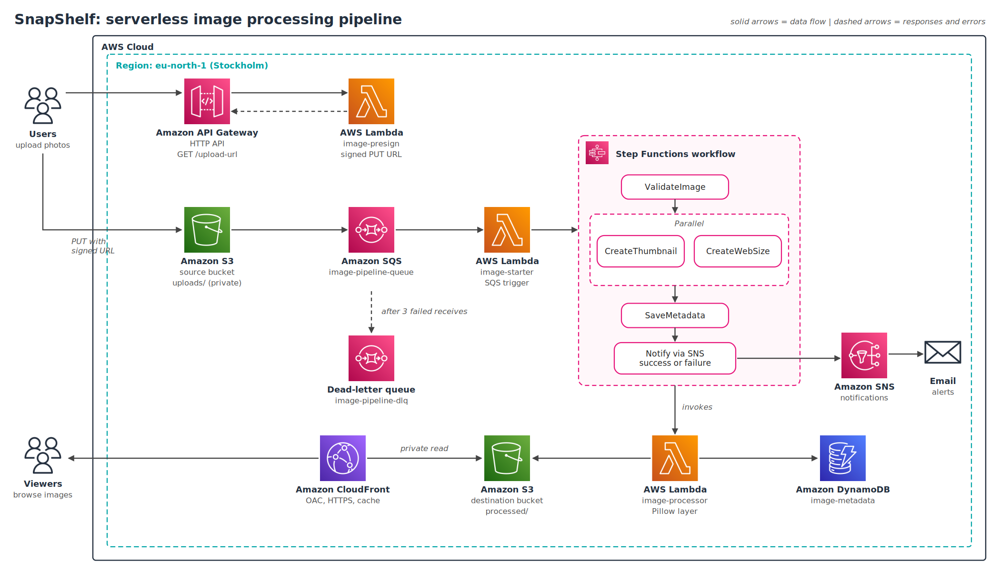

*Figure 1: Overall solution architecture.*

The three diagrams below zoom into each part.

### **3.1 Upload flow**

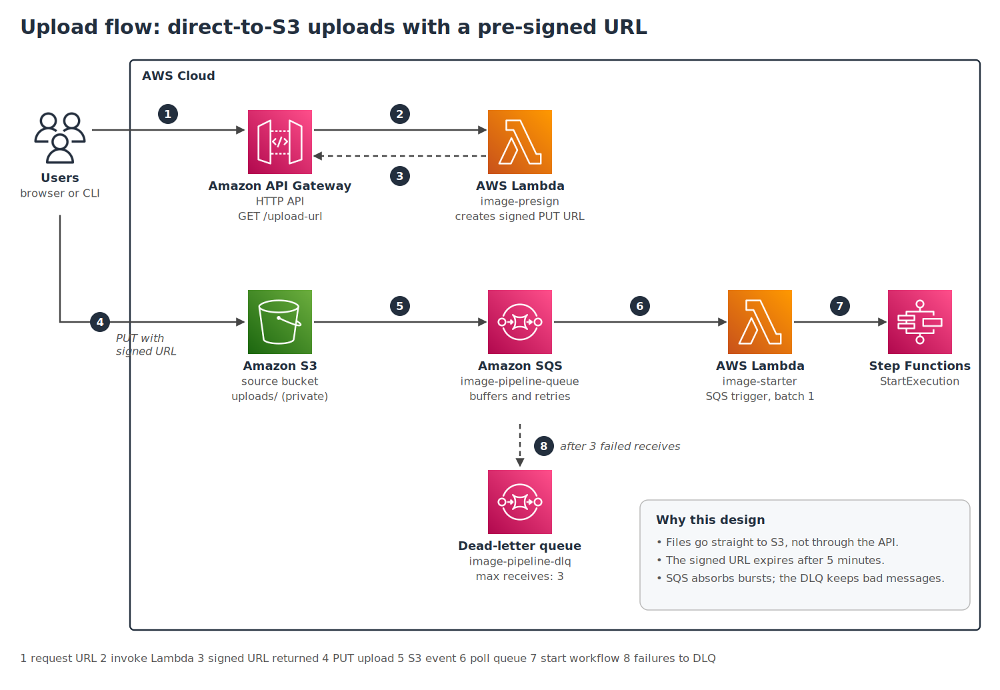

*Figure 2: Direct-to-S3 uploads with a pre-signed URL, decoupled by SQS with a dead-letter queue.*

### **3.2 Processing workflow**

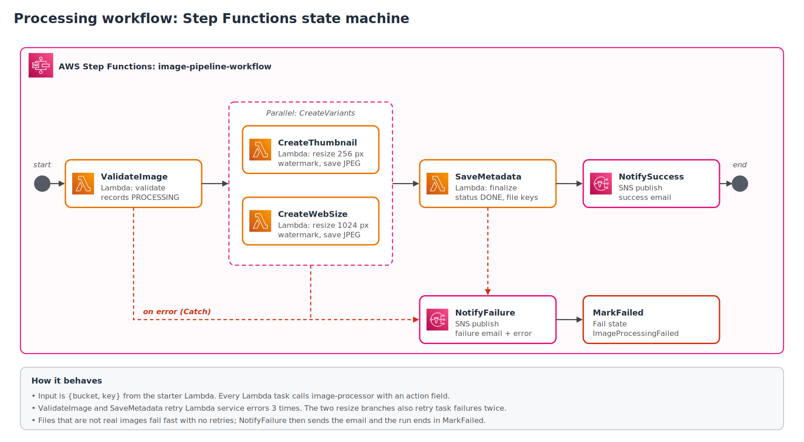

*Figure 3: The Step Functions state machine, including parallel processing and error handling.*

### **3.3 Delivery and security**

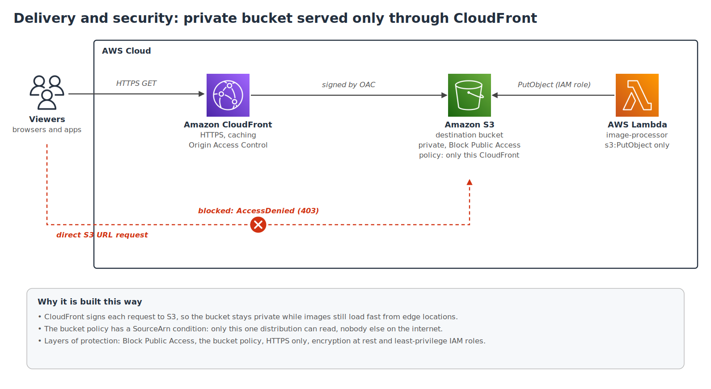

*Figure 4: CloudFront with Origin Access Control in front of a private bucket.*

---

## **4\. AWS services and why they were chosen**

| Service | Role in this project | Why it fits |
| ----- | ----- | ----- |
| **Amazon S3** (source bucket) | Receives raw uploads | Durable, scales without limit, emits events |
| **Amazon S3** (destination bucket) | Stores thumbnails and web versions | Cheap and durable; lifecycle rules manage cost |
| **Amazon SQS** | Buffers upload events | Decouples upload from processing, absorbs bursts, enables retries |
| **SQS dead-letter queue** | Holds messages that keep failing | Prevents endless retries and keeps evidence for investigation |
| **AWS Lambda** | `image-presign`, `image-starter`, `image-processor` | Runs code only when needed, scales automatically |
| **Lambda layer** | Packages the Pillow imaging library | Keeps the function small and the library reusable |
| **AWS Step Functions** | Orchestrates validate, resize and save | Visual workflow, built-in retries, catch and parallel states |
| **Amazon API Gateway** (HTTP API) | Exposes `GET /upload-url` | Simple, low-cost public endpoint for the signing Lambda |
| **Amazon DynamoDB** | Stores image metadata | Single-digit millisecond lookups, on-demand pricing |
| **Amazon SNS** | Success and failure emails | Simple pub/sub; more subscribers can be added later |
| **Amazon CloudFront** | Serves processed images | Edge caching, HTTPS, hides the private bucket |
| **AWS IAM** | Roles and policies | Least-privilege access for every component |
| **Amazon CloudWatch** | Logs for each Lambda | Debugging and monitoring |

---

## **5\. How it works**

1. **Request an upload URL.** The client calls `GET /upload-url?filename=cat.png&contentType=image/png`. API Gateway invokes the `image-presign` Lambda.  
2. **Receive a signed URL.** The Lambda validates the content type, builds a unique key under `uploads/`, and returns a pre-signed `PUT` URL that expires in 5 minutes.  
3. **Upload directly to S3.** The client sends the file to the signed URL. The file never passes through the API or a Lambda.  
4. **S3 emits an event.** An `ObjectCreated` event notification sends a message to the SQS queue.  
5. **The queue decouples.** SQS holds the message. If processing fails repeatedly (3 receives), the message moves to the dead-letter queue.  
6. **The starter Lambda reacts.** The `image-starter` Lambda (SQS trigger, batch size 1\) reads the message and starts one Step Functions execution with `{bucket, key}`.  
7. **The workflow runs:**  
   * `ValidateImage` checks the file is a real image (JPEG, PNG or WEBP) by content, records `PROCESSING` in DynamoDB.  
   * `CreateVariants` runs two branches **in parallel**: `CreateThumbnail` (256 px) and `CreateWebSize` (1024 px). Both apply the phone rotation, add a watermark and save JPEG files to the destination bucket.  
   * `SaveMetadata` records `DONE`, the original size and format, and both output keys.  
   * `NotifySuccess` publishes to SNS.  
8. **Errors are handled.** Any failure goes to `NotifyFailure` (SNS email with the error) and ends in the `MarkFailed` state. Invalid files fail fast without retries, while transient errors are retried with backoff.  
9. **Delivery.** CloudFront serves `processed/thumbnails/*` and `processed/web/*` from the private destination bucket using Origin Access Control.

### **Processed object layout**

saa3-project-s3-destination-bucket/  
└── processed/  
    ├── thumbnails/\<id\>-\<name\>.jpg   (up to 256 px)  
    └── web/\<id\>-\<name\>.jpg          (up to 1024 px)

### **DynamoDB item (table `image-metadata`, partition key `imageId`)**

| Attribute | Example |
| ----- | ----- |
| `imageId` | `uploads/ab12cd34-photo.png` |
| `status` | `PROCESSING`, `DONE` or `FAILED` |
| `originalFormat`, `originalWidth`, `originalHeight`, `originalBytes` | `PNG`, `96`, `86`, `9777` |
| `thumbnailKey`, `webKey` | `processed/thumbnails/...jpg`, `processed/web/...jpg` |
| `error` | Present only when `FAILED` |
| `updatedAt` | Unix timestamp |

---

## **6\. Design decisions**

* **Two buckets, not one.** Writing results into the bucket that triggers the pipeline would create an endless loop. Separate buckets also allow different permissions and lifecycle rules.  
* **Pre-signed URLs.** Uploads bypass the API's payload limits and avoid paying for compute to move bytes. The bucket stays private.  
* **SQS between S3 and processing.** Decoupling makes the system resilient to bursts and failures, and the DLQ preserves problem messages.  
* **Step Functions instead of one big Lambda.** Steps are small, individually retried and visible in the console. The parallel state creates both sizes at the same time.  
* **One Lambda with three actions.** `image-processor` handles `validate`, `resize` and `finalize`, selected by an `action` field. This keeps one deployment package and one layer while still giving the workflow separate, observable steps.  
* **Validation by content.** Pillow inspects the file itself, so a renamed or corrupted file is rejected whatever its extension says.  
* **Fail fast on permanent errors.** An invalid file is not retried; only transient service errors and resize failures are.  
* **On-demand DynamoDB.** Traffic is bursty and mostly idle, so pay-per-request fits better than provisioned capacity.  
* **CloudFront with Origin Access Control.** Images are cached at the edge while the bucket is not publicly readable.  
* **Lifecycle rules.** Raw uploads expire after 30 days; processed images move to Standard-IA after 30 days.

---

## **7\. Security**

| Layer | Control |
| ----- | ----- |
| Storage | Both buckets have **Block all public access** turned on and SSE-S3 encryption at rest |
| Access to images | Destination bucket policy allows only the CloudFront distribution (`aws:SourceArn` condition) |
| Uploads | Pre-signed URLs expire after 5 minutes and are limited to one key and one content type |
| Permissions | Each Lambda has its own role with only the actions it needs |
| Transport | CloudFront redirects HTTP to HTTPS |
| Queue | The queue policy allows only the source bucket in this account to send messages |
| Secrets | No access keys exist anywhere in this project; everything uses IAM roles |

---

## **8\. Repository structure**

.  
├── README.md  
├── .gitignore  
├── architecture/  
│   ├── architecture.png / .svg  
│   ├── upload-flow.png / .svg  
│   ├── workflow.png / .svg  
│   └── delivery-security.png / .svg  
├── src/  
│   ├── presign/app.py       
│   ├── starter/app.py       
│   └── processor/app.py      
├── statemachine/  
│   └── workflow.asl.json       
└── screenshots/              

---

## **9\. Deployment guide**

The project was built manually in the AWS console in `eu-north-1`. Bucket names must be globally unique, so use your own names and replace them below. Replace `<ACCOUNT_ID>` everywhere with your AWS account ID.

### **Step 1: S3 buckets**

Create two **private** buckets (keep *Block all public access* on):

* `saa3-project-s3-source-bucket` (raw uploads)  
* `saa3-project-s3-destination-bucket` (processed images)

**CORS on the source bucket** (needed for browser uploads):

\[  
  {  
    "AllowedHeaders": \["\*"\],  
    "AllowedMethods": \["PUT"\],  
    "AllowedOrigins": \["\*"\],  
    "ExposeHeaders": \["ETag"\],  
    "MaxAgeSeconds": 3000  
  }  
\]

> `AllowedOrigins: *` is acceptable for a demo. In production, restrict it to your own site's address.

**Lifecycle rules**

| Bucket | Rule name | Action |
| ----- | ----- | ----- |
| Source | `expire-raw-uploads` | Expire current objects after 30 days; delete incomplete multipart uploads after 7 days |
| Destination | `archive-processed` | Transition to Standard-IA after 30 days |

### **Step 2: SQS queues**

1. Create the dead-letter queue `image-pipeline-dlq` (Standard, 14 day retention).  
2. Create `image-pipeline-queue` (Standard, visibility timeout 60 seconds) and enable the **dead-letter queue** with `image-pipeline-dlq` and **maximum receives \= 3**.  
3. Allow the source bucket to send messages by setting this queue access policy:

{  
  "Version": "2012-10-17",  
  "Id": "AllowS3ToSendMessages",  
  "Statement": \[  
    {  
      "Sid": "AllowS3Send",  
      "Effect": "Allow",  
      "Principal": { "Service": "s3.amazonaws.com" },  
      "Action": "sqs:SendMessage",  
      "Resource": "arn:aws:sqs:eu-north-1:\<ACCOUNT\_ID\>:image-pipeline-queue",  
      "Condition": {  
        "ArnLike": { "aws:SourceArn": "arn:aws:s3:::saa3-project-s3-source-bucket" },  
        "StringEquals": { "aws:SourceAccount": "\<ACCOUNT\_ID\>" }  
      }  
    }  
  \]  
}

4. On the source bucket, create an **event notification** named `new-upload` for **All object create events** with the SQS queue as the destination.

### **Step 3: DynamoDB table**

Create the table `image-metadata` with partition key `imageId` (String) and **on-demand** capacity.

### **Step 4: Pillow Lambda layer**

Build the layer in **AWS CloudShell** (region `eu-north-1`) so it matches the Lambda runtime (Python 3.12, x86\_64):

mkdir \-p layer/python && cd layer  
pip install \--platform manylinux2014\_x86\_64 \--target python \\  
  \--implementation cp \--python-version 3.12 \--only-binary=:all: pillow  
zip \-r pillow-layer.zip python  
aws lambda publish-layer-version \--layer-name pillow-layer \\  
  \--zip-file fileb://pillow-layer.zip \\  
  \--compatible-runtimes python3.12 \--compatible-architectures x86\_64

> The layer zip is not stored in this repository. Rebuild it with the commands above.

### **Step 5: Lambda functions**

All functions use **Python 3.12, x86\_64**, each with its **own execution role**.

| Function | Code | Memory | Timeout | Environment variables | Other |
| ----- | ----- | ----- | ----- | ----- | ----- |
| `image-processor` | `src/processor/app.py` | 512 MB | 30 s | `DEST_BUCKET`, `TABLE_NAME` | Attach `pillow-layer` |
| `image-starter` | `src/starter/app.py` | 128 MB | 15 s | `STATE_MACHINE_ARN` | SQS trigger on `image-pipeline-queue`, batch size 1 |
| `image-presign` | `src/presign/app.py` | 128 MB | 10 s | `SOURCE_BUCKET` | Called by API Gateway |

**Role policy for `image-processor`** (in addition to basic logging):

{  
  "Version": "2012-10-17",  
  "Statement": \[  
    { "Effect": "Allow", "Action": "s3:GetObject",  
      "Resource": "arn:aws:s3:::saa3-project-s3-source-bucket/\*" },  
    { "Effect": "Allow", "Action": "s3:ListBucket",  
      "Resource": "arn:aws:s3:::saa3-project-s3-source-bucket" },  
    { "Effect": "Allow", "Action": "s3:PutObject",  
      "Resource": "arn:aws:s3:::saa3-project-s3-destination-bucket/\*" },  
    { "Effect": "Allow", "Action": "dynamodb:UpdateItem",  
      "Resource": "arn:aws:dynamodb:eu-north-1:\<ACCOUNT\_ID\>:table/image-metadata" }  
  \]  
}

**Role policy for `image-starter`**: attach the managed policy `AWSLambdaSQSQueueExecutionRole` plus:

{  
  "Version": "2012-10-17",  
  "Statement": \[  
    { "Effect": "Allow", "Action": "states:StartExecution",  
      "Resource": "arn:aws:states:eu-north-1:\<ACCOUNT\_ID\>:stateMachine:image-pipeline-workflow" }  
  \]  
}

**Role policy for `image-presign`** (the signed URL inherits this permission):

{  
  "Version": "2012-10-17",  
  "Statement": \[  
    { "Effect": "Allow", "Action": "s3:PutObject",  
      "Resource": "arn:aws:s3:::saa3-project-s3-source-bucket/\*" }  
  \]  
}

### **Step 6: SNS topic**

Create a Standard topic `image-pipeline-notifications`, add an **Email** subscription, and **confirm** it from your inbox.

### **Step 7: Step Functions state machine**

Create a Standard state machine `image-pipeline-workflow` using the definition in [`statemachine/workflow.asl.json`](statemachine/workflow.asl.json). Replace `<ACCOUNT_ID>` in the ARNs. The state machine's role must be allowed to invoke `image-processor` and publish to the SNS topic:

{  
  "Version": "2012-10-17",  
  "Statement": \[  
    { "Effect": "Allow", "Action": "lambda:InvokeFunction",  
      "Resource": \[  
        "arn:aws:lambda:eu-north-1:\<ACCOUNT\_ID\>:function:image-processor",  
        "arn:aws:lambda:eu-north-1:\<ACCOUNT\_ID\>:function:image-processor:\*"  
      \] },  
    { "Effect": "Allow", "Action": "sns:Publish",  
      "Resource": "arn:aws:sns:eu-north-1:\<ACCOUNT\_ID\>:image-pipeline-notifications" }  
  \]  
}

### **Step 8: API Gateway (HTTP API)**

1. Create an HTTP API `image-upload-api` with a Lambda integration to `image-presign`.  
2. Add the route `GET /upload-url`.  
3. Keep the `$default` stage with automatic deployment.  
4. Configure CORS: allow origin `*`, method `GET`, header `content-type`.

### **Step 9: CloudFront**

1. Create a distribution `image-pipeline-cdn` with the **destination bucket** as an S3 origin.  
2. Choose **Origin Access Control** and let CloudFront create it. Redirect HTTP to HTTPS and use the recommended caching settings.  
3. Add the bucket policy to the destination bucket (replace the distribution ID):

{  
  "Version": "2008-10-17",  
  "Id": "PolicyForCloudFrontPrivateContent",  
  "Statement": \[  
    {  
      "Sid": "AllowCloudFrontServicePrincipal",  
      "Effect": "Allow",  
      "Principal": { "Service": "cloudfront.amazonaws.com" },  
      "Action": "s3:GetObject",  
      "Resource": "arn:aws:s3:::saa3-project-s3-destination-bucket/\*",  
      "Condition": {  
        "ArnLike": {  
          "AWS:SourceArn": "arn:aws:cloudfront::\<ACCOUNT\_ID\>:distribution/\<DISTRIBUTION\_ID\>"  
        }  
      }  
    }  
  \]  
}

---

## **10\. Testing**

### **10.1 Upload an image through the API (PowerShell)**

\$api  \= "https\://\<API\_ID\>.execute-api.eu-north-1.amazonaws.com/upload-url"  
\$file \= "C:\\Users\\\<USER\>\\Downloads\\photo.png"  
\$name \= Split-Path \$file \-Leaf  
$r=Invoke-RestMethod"$api\`?filename=\$name\&contentType=image/png"  
curl.exe \-X PUT \-H "Content-Type: image/png" \--upload-file \$file \$r.uploadUrl  
\$r.key

The last line prints the object key, for example `uploads/ab12cd34-photo.png`. For a JPG, use `image/jpeg` in both places.

### **10.2 Expected result**

Within about 15 seconds:

1. A new Step Functions execution appears and turns **green**.  
2. `processed/thumbnails/ab12cd34-photo.jpg` and `processed/web/ab12cd34-photo.jpg` exist in the destination bucket.  
3. DynamoDB shows `status = DONE` with both output keys.  
4. A success email arrives.  
5. The image loads at `https://<DISTRIBUTION_DOMAIN>.cloudfront.net/processed/web/ab12cd34-photo.jpg`.  
6. The direct S3 address of the same file returns **AccessDenied**.

### **10.3 Failure test**

Upload a file that is not an image (for example a PDF or Word document with a `.png` name). `ValidateImage` fails immediately, `NotifyFailure` sends an email with the error, the run ends in `MarkFailed`, and DynamoDB records `status = FAILED` with the error text.

---

## **11\. Screenshots**

### **11.1 Storage and security**

**S3 buckets**

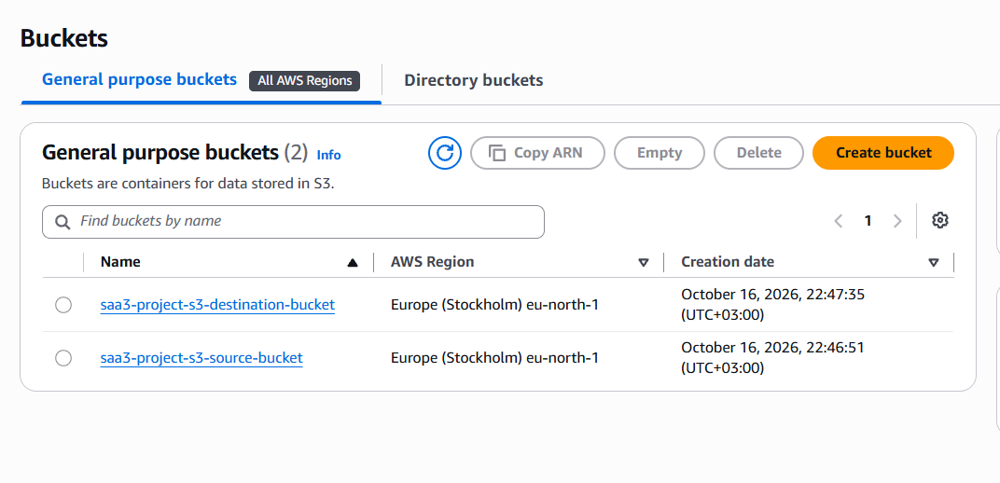

**Block Public Access enabled**

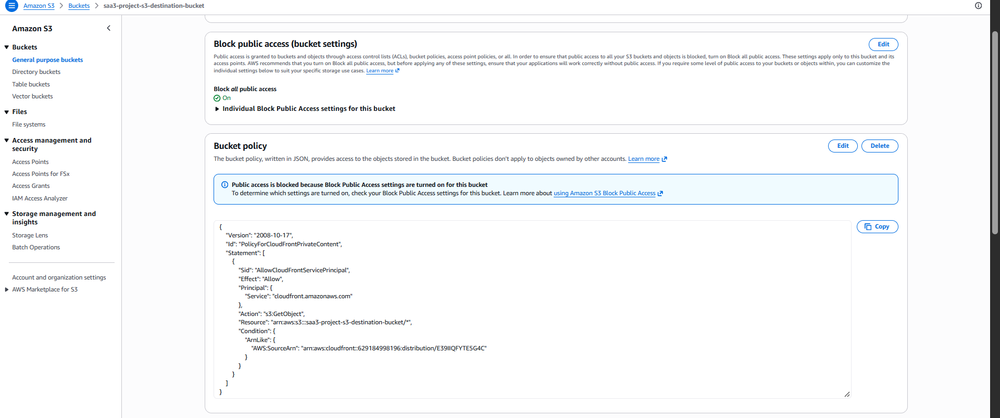

**Destination bucket policy (CloudFront only)**

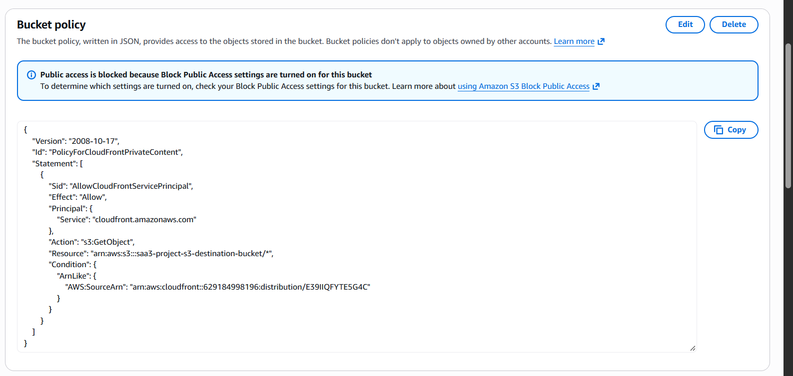

**S3 event notification to SQS**

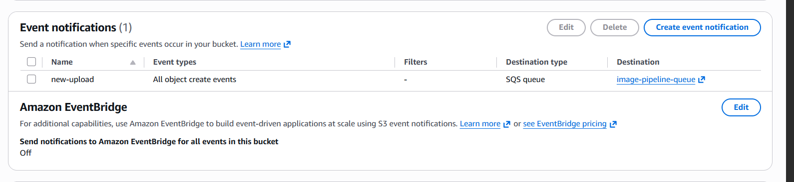

**CORS rule on the source bucket**

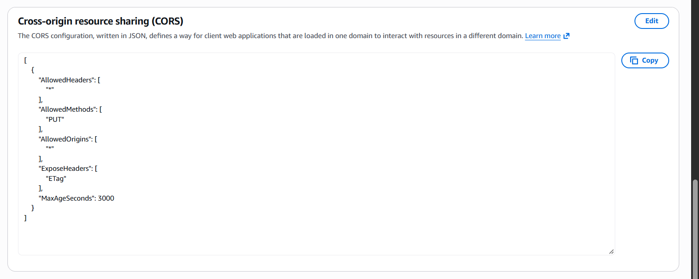

**Lifecycle rules**

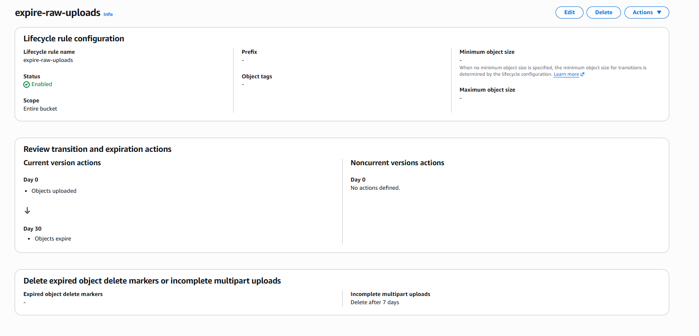

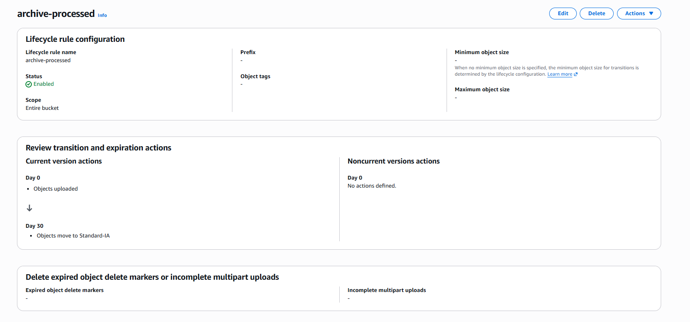

### **11.2 Queue and decoupling**

**Main queue with the dead-letter queue (max receives \= 3\)**

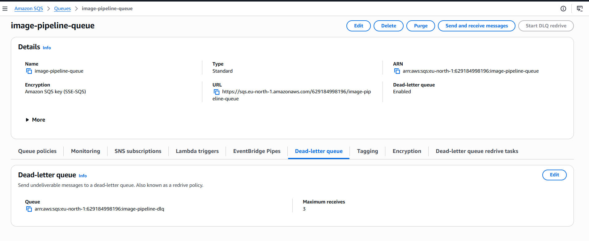

**Both queues**

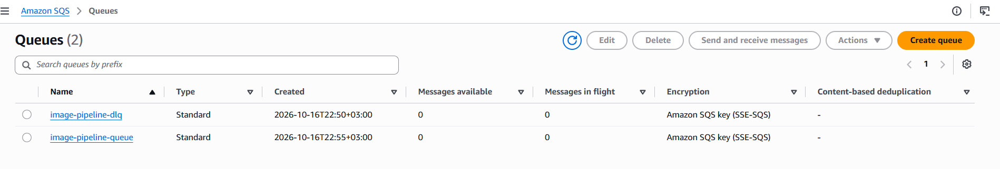

### **11.3 Compute**

**Lambda functions**

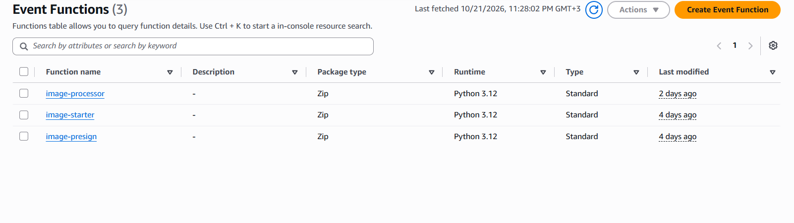

**Pillow layer**

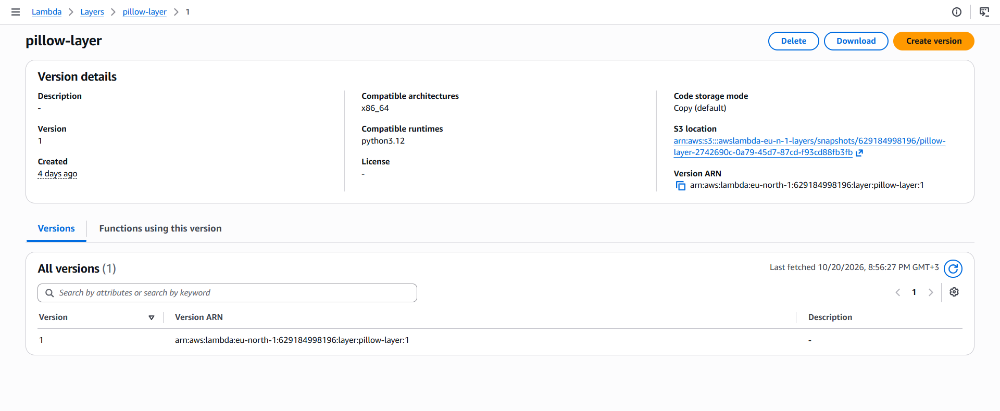

**SQS trigger on the starter Lambda**

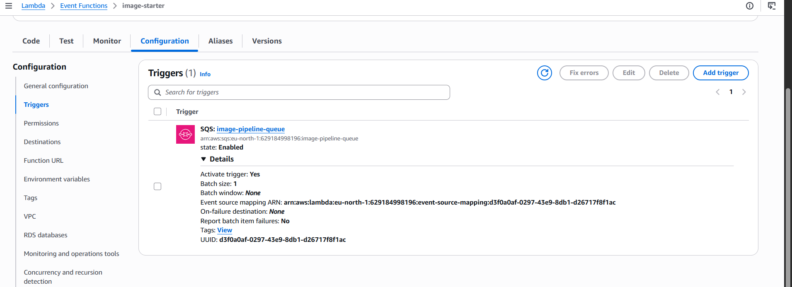

**Least-privilege role policy**

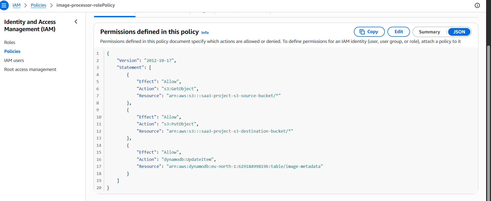

### **11.4 Workflow**

**Successful execution with parallel branches**

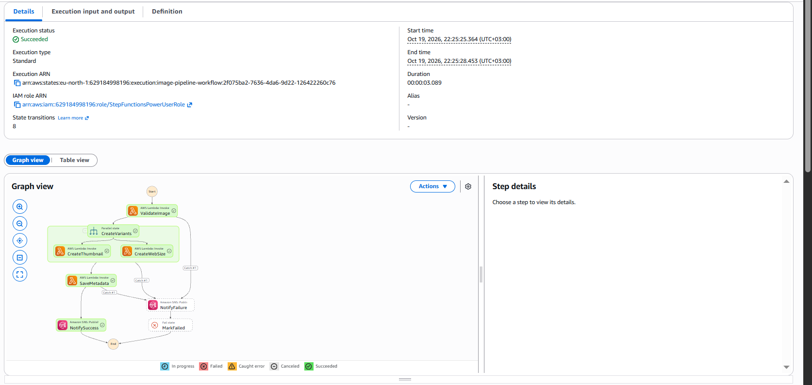

**Failed execution (invalid file) with error handling**

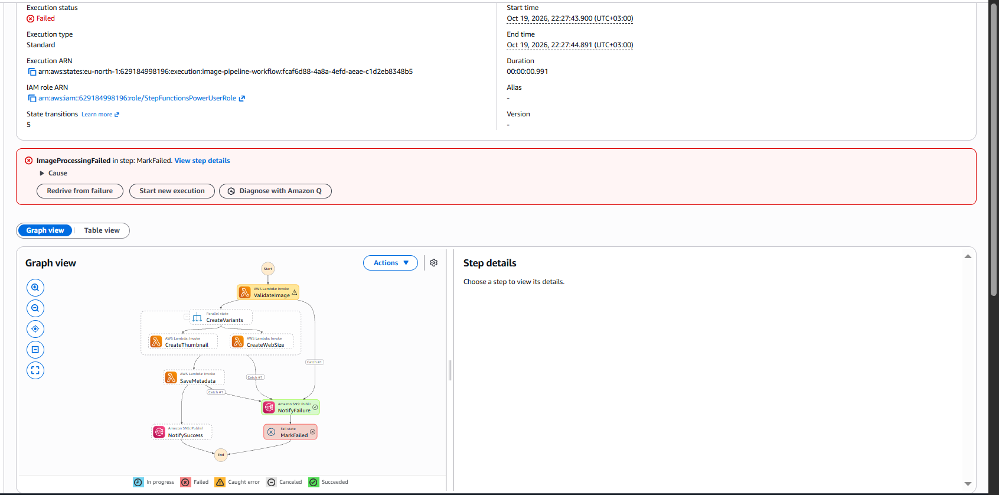

### **11.5 Data and notifications**

**DynamoDB item, status DONE**

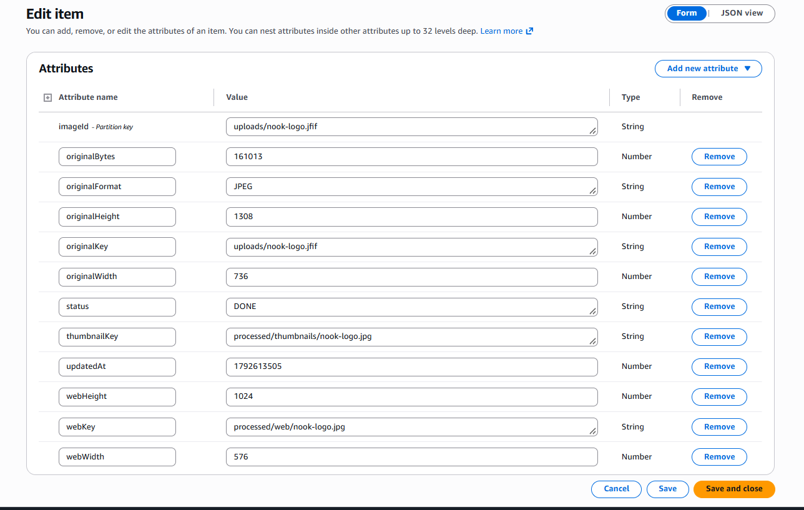

**DynamoDB item, status FAILED**

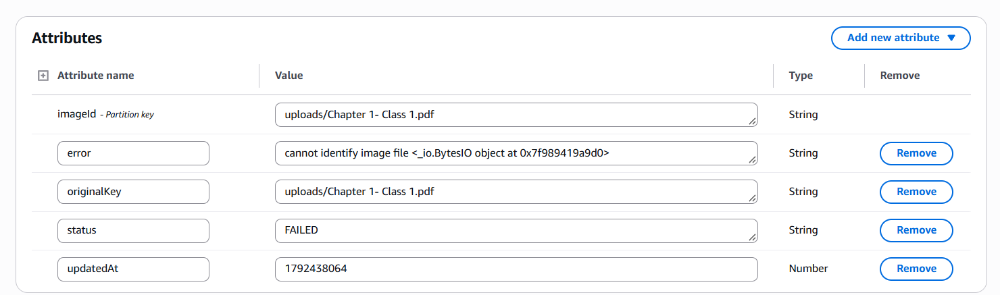

**Success email**

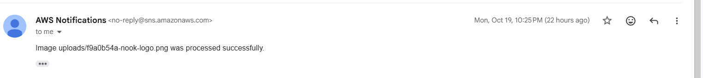

**Failure email**

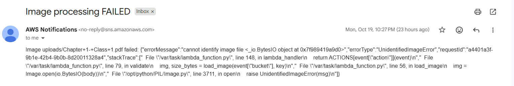

### **11.6 API and delivery**

**API route**

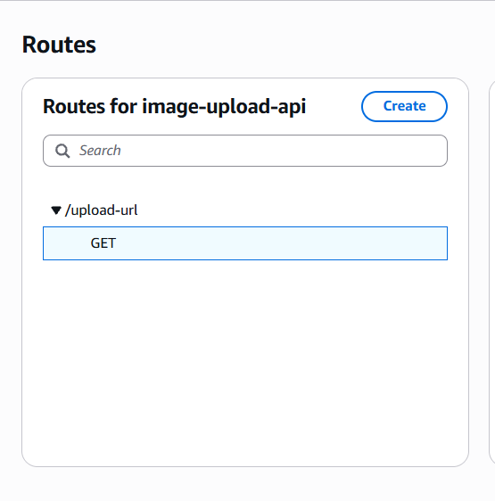

**API response (signature hidden)**

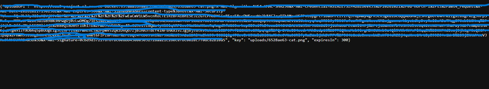

**Upload from PowerShell**

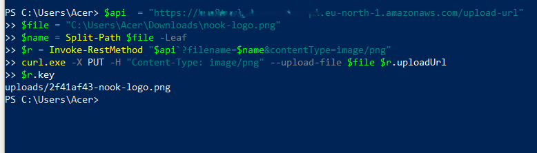

**Processed objects in the destination bucket**

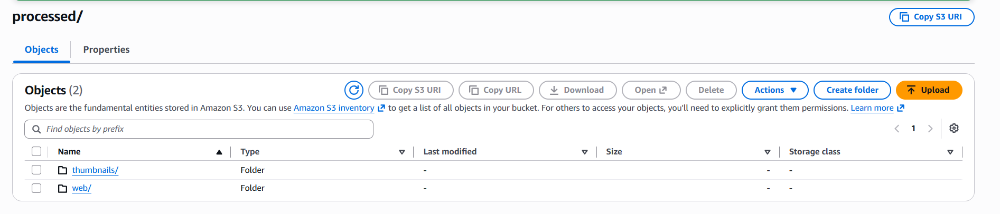

**CloudFront distribution**

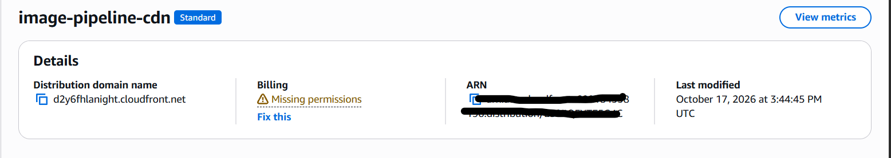

**Image served through CloudFront**

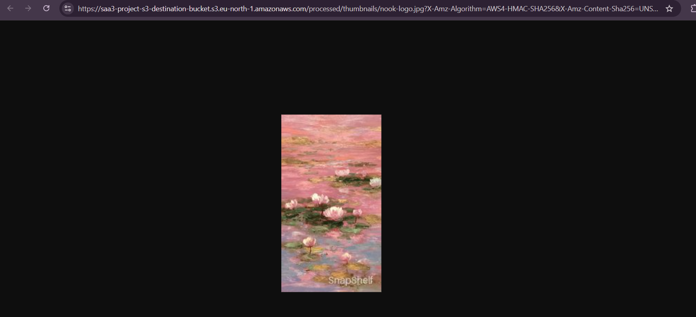

**Direct S3 access is denied**

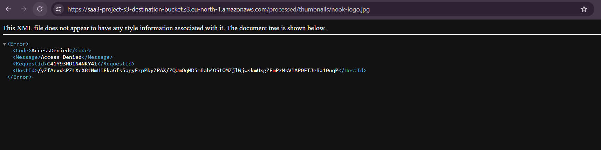

## **12\. Cost**

The design has **no always-on resources**, so idle cost is close to zero. At demo scale (a handful of test images), the combined cost of Lambda, SQS, Step Functions, SNS, DynamoDB on-demand, API Gateway and CloudFront stays within free-tier allowances or amounts to cents. S3 storage is billed per GB and is tiny for test images.

Cost-control measures in the design:

* On-demand DynamoDB and per-request services, so nothing is billed while idle.  
* S3 lifecycle rules delete raw uploads and move processed images to cheaper storage.  
* CloudFront caching reduces requests to S3.  
* Thumbnails keep list pages small, which reduces data transfer.

> Check the current AWS pricing pages for exact rates, as they change over time.

---

## **13\. Cleanup**

To avoid charges after grading, delete the resources in this order:

1. Disable, then delete the **CloudFront** distribution.  
2. Empty and delete both **S3 buckets**.  
3. Delete the **API Gateway** HTTP API.  
4. Delete the **Lambda** functions and the **Pillow layer**.  
5. Delete the **Step Functions** state machine.  
6. Delete the **SQS** queues and the **SNS** topic (and the email subscription).  
7. Delete the **DynamoDB** table.  
8. Delete the **IAM roles** created for the Lambda functions and the state machine.  
9. Delete the CloudWatch log groups for the Lambda functions.

---

## **14\. Limitations and future improvements**

* **The upload API is open.** Anyone who knows the URL can request a signed link. A production version would add authentication (Amazon Cognito or an API key), throttling and AWS WAF.  
* **No size limit on uploads.** A pre-signed `PUT` cannot limit file size. A pre-signed `POST` with a content-length condition would.  
* **Single processing Lambda.** The workflow has separate steps, but they call one function with different actions. Separate functions per step would allow independent scaling and permissions.  
* **Broad state machine role.** The state machine used an existing broad role in this build. A dedicated role scoped to one Lambda and one SNS topic is the production choice.  
* **CORS is open** (`*`) for the demo and should be limited to the real website origin.  
* **Alarms.** Add a CloudWatch alarm on the dead-letter queue and on Lambda errors, with SNS alerts.  
* **Infrastructure as code.** Rebuild the stack with AWS SAM, CloudFormation or Terraform so it can be deployed repeatedly with one command.  
* **More processing.** Content moderation (Amazon Rekognition), metadata extraction, or additional output sizes.

---

## **15\. Learning outcomes**

* Designed an **event-driven architecture** with S3 event notifications and SQS.  
* Explained why **SQS decoupling** improves resilience, and configured a **dead-letter queue** and retries.  
* Packaged a large dependency with a **Lambda layer**.  
* Orchestrated a **multi-step workflow** with Step Functions, including a **parallel state**, retries and catch handlers.  
* Generated **pre-signed URLs** and configured CORS for direct browser uploads.  
* Applied **S3 lifecycle policies** to expire and transition objects.  
* Served private content globally through **CloudFront with Origin Access Control**.  
* Applied **least-privilege IAM** roles and policies.  
* Debugged real issues using CloudWatch logs and Step Functions execution history (layer architecture mismatch, environment variable whitespace, S3 permissions, image orientation).

---

